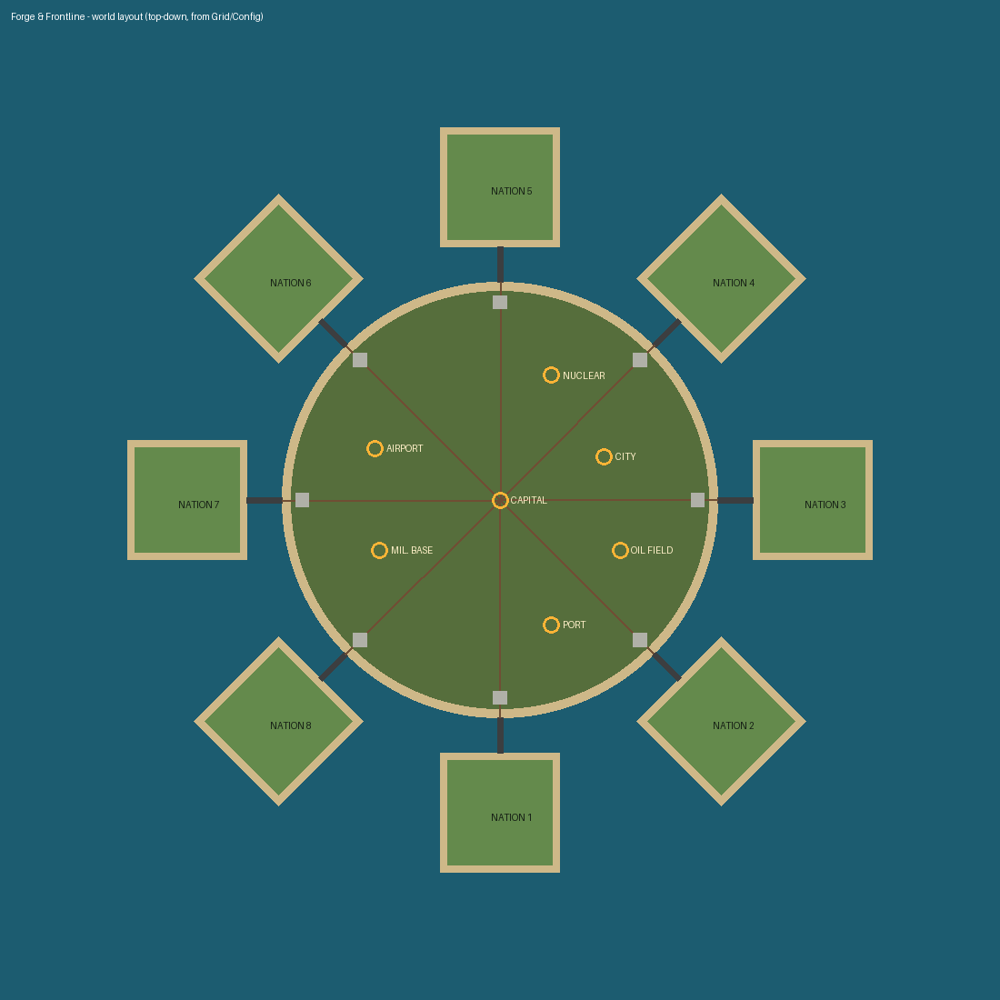
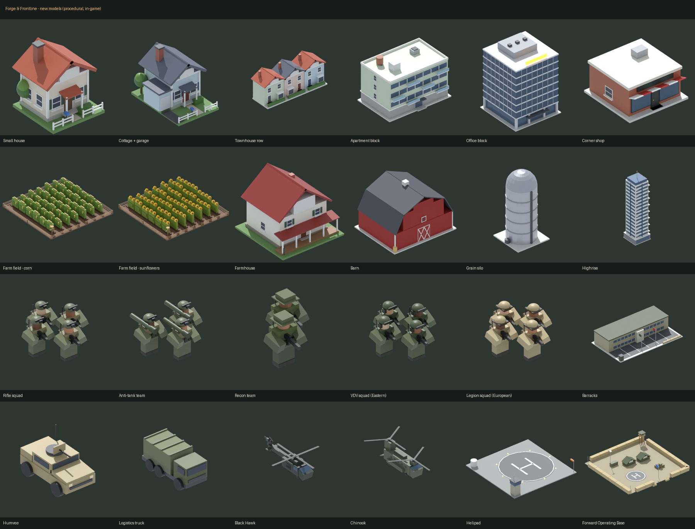

# Forge & Frontline

A Roblox nation-builder / war game inspired by *Build and Conquer*, with its own identity. Found a nation with your own name and flag, build a city however you like, run an economy, refine oil into fuel, research weapons, mass-produce missiles, drones and armour, then drive over your bridge to the central front to capture strategic points, invade rivals, strike their cities and climb from **Outpost** to **Superpower**.



**The map:** a round central battlefield with seven strategic points sits in the middle. Up to eight nation islands ring it, each facing the centre, and each is joined to the battlefield by its own bridge with a border gate and a staging pad. Vehicles physically drive out over that bridge. Missiles launch from your launchers and arc across the battlefield to their target.

- **Field Command UI:** a dark tactical-glass interface with amber signal accents, a stencil display font, corner brackets and hazard stripes. It is drawn entirely in code (no image IDs), with a command dock, a radar minimap and a war-room theater view.
- **Blender model kit:** 89 hand-built stylized low-poly models (55 buildings, 11 vehicles, 7 munitions, 6 battlefield sites, a fuel truck and props) with baked palette UVs. They are exported as FBX for Studio's 3D Importer, and the game picks them up automatically.
- **Always playable:** until the kit is imported, every model falls back to a clean procedural part-built version, so the place works the moment you open it. The procedural set includes remodelled houses, apartments, offices and shops, farms, classic Roblox-character infantry, Humvees, helicopters and FOBs (see below).



## Quick start

**Option A: just open it**
1. Open `build/ForgeAndFrontline.rbxlx` in Roblox Studio.
2. Press **Play**. In Studio, store purchases are free so you can test every perk.

**Option B: add the Blender models** (recommended before publishing)
1. In Studio: **File → Import 3D** (the 3D Importer). Import `assets/FF_Buildings.fbx`, `assets/FF_Vehicles.fbx` and `assets/FF_World.fbx` with the default settings. Scale doesn't matter, because the game fits every model to its footprint.
2. Move the imported models into `ReplicatedStorage › Assets` (the folder already exists).
3. Press **Play**. `AssetLibrary` indexes every mesh named `<asset>__<Part>`, rescales it to the exact footprint, turns vehicles to face forward, rigs rotors, radar dishes and pump beams, and wires the night-time window glow. Anything you don't import keeps its procedural model.
4. **Publish** the place once so the uploaded meshes are saved with it.

**Option C: develop with Rojo**
```bash
rokit install                      # installs rojo + lune from rokit.toml
rojo serve                         # then connect from the Rojo Studio plugin
rojo build -o build/ForgeAndFrontline.rbxlx   # or rebuild the place file
```

## Before you publish (checklist)

1. **Data saving:** Game Settings → Security → *Enable Studio Access to API Services*. Without it, Studio shows a yellow "data not saved" chip and nothing persists.
2. **Server size:** set Max Players to **8** (one island per player, `Config.MaxPlots`).
3. **Monetization:** create the game passes and developer products listed below on the Creator Hub, then paste each ID into `src/shared/Catalog/Products.luau`. Items with `id = 0` show "not on sale" in live servers.
4. **Group reward:** set `Config.GroupId` in `src/shared/Config.luau` (0 disables it).
5. **Codes:** edit `Config.Codes` (`FORGE`, `FRONTLINE` and `RELEASE` ship as examples).
6. **Audio (optional):** the game uses sounds that ship with Roblox. Swap in your own IDs in `src/client/Controllers/Sounds.luau`.

## How it plays

| System | What happens |
|---|---|
| **Found a nation** | First join opens the founding screen. Pick a name (text-filtered, 3–20 characters) and design a flag from 6 patterns, 12 colours and 5 emblems, with a live preview on a pole. The flag flies over your island, sits on your border sign, tags you on the war map and shows in the HUD. Click the flag to change it any time. |
| **Ranks** | Power = population + building value + tech + vehicles + captured points. Six ranks, from Outpost to Township, City-State, Republic, Federation and Superpower, each pay a one-time treasury bonus with a RANK UP banner. Power is on the leaderboard. |
| **Command dock** | Build `B`, Army `G`, Research `T`, War Map `M`, Rewards `J`, Store, with live badges. The radar minimap (bottom-right) shows your island (front edge up) at home, and the whole map in war view: the battlefield, every island and bridge, point owners and vehicles. |
| **Free-form building** (`B`) | No grid blocks or zones: put roads, housing, industry, services and military anywhere on your 480-stud island, **at any angle**. `R` turns 15° (`Shift+R` back). `G` switches FREE / GRID (4-stud grid, quarter turns). In FREE mode, buildings near a road turn to face it and sit flush with the kerb (hold `Alt` to place freely). Overlap is checked on the real rotated footprints, on the client ghost and again on the server. |
| **Roads** | Drawn point to point at any length (up to 240 studs per piece) and in any direction: click a start, then click or drag to lay each piece. The road keeps going from the last point until you click the same spot twice, right-click or press `Q`. Ends snap onto other roads' ends and centrelines, and `Shift` snaps the angle to 15°. Roads can cross to make junctions, and the price scales with length ($40 per 8 studs). |
| **Build menu** | A department column (Civilian / Military), tabs, and cards with 3D model thumbnails, price and build-time chips and locked badges. Also a Standard / Eastern / European faction toggle, a spinning preview with stats, and DEMOLISH `2`, UNDO `3`, DRAG `4` (lay a row), MOVE `5`, ROTATE `6`/`R` and SNAP `G` tools. A tooltip shows the angle, road length and live cost. |
| **Day & night** | A 16-minute cycle with short nights. Windows across every city light up after dusk (a few stay dark), kit lamps and beacons glow, and the scene shifts to a cool night grade. The sea is real terrain water. |
| **Economy** | Pay day every 60 s. Taxes scale with population and happiness; shops, offices and factories add income; buildings cost upkeep. |
| **Utilities** | Workers, power (MW) and water are pooled per nation. Shortages slow every building that needs them. Buildings without road access run at half speed. |
| **Happiness** | Leisure, commerce, education and health coverage raise it. Pollution, shortages and damaged buildings lower it. It drives tax income and population growth. |
| **Oil → fuel → war** | Oil pumps fill national storage. Refineries refine fuel, and **fuel trucks visibly drive** it to military factories. The destination is either Auto (most free space) or one you pick, as in the refinery panel. |
| **Production** | Each production building works through a queue: Military Factories build missiles, drones and vehicles, the **Barracks** trains infantry squads, and the **Helipad** builds helicopters. Each item costs cash up front, steel when it starts, and burns fuel while it builds (infantry needs no fuel). |
| **Farms** (Farms tab) | Place Farm Fields anywhere and plant wheat, potatoes, corn or sunflowers. Each crop has its own seed cost, growth time and yield. Fields grow through four visible stages (ploughed, sprouts, growing, ripe), faster with farmhands and with a Farmhouse or Barn nearby. Walk up and press `E` to harvest or replant, or use the field's panel (plant, harvest, harvest all, auto-replant, sell food). Food is stored in barns and silos, and citizens eat it every pay day, which gives a happiness bonus while they're fed. Overflow sells for cash, and food is packed into FOB supplies. |
| **Research** | Labs generate RP. The Civil and Military trees unlock buildings and weapons. The missile ladder (SRBM → GLCM → MRBM → Cluster → Hypersonic) also needs confirmed **hits**. |
| **War map** (`M`) | The theater select lists the central front (points held, vehicles deployed) and every rival nation with its flag, rank, power and PvP state. The strategic camera adds a vignette, a theater readout (grid and altitude), a weapon hotbar (stock, reload and ammo bars), and a reticle that names what's under it before you launch. |
| **Air defense** | CIWS, SAM and long-range SAM intercept incoming strikes in range (radar adds 25%). Interceptors visibly meet missiles mid-air. |
| **Units** | Three classes. **Infantry** are squads of classic Roblox (R6) soldiers with distinct kit: Rifle Squad (plate carriers, NVG helmets), Anti-Tank Team (rocket launchers), Recon Team (boonie hats and ghillie wraps), VDV (Eastern digital camo, heavy helmets) and Legion (European desert kit); their legs swing as they march. **Vehicles** are Humvee, Logistics Truck, Marder, Leopard, HIMARS, Gepard and faction variants. **Helicopters** are the Black Hawk (door guns) and Chinook (twin rotors), with spinning rotors. Ground units really drive and march: out of your city, across your bridge, over the battlefield and, with PvP on, across a rival's bridge into their city. Helicopters fly straight there at altitude and land. Drag-box select, then right-click to move. Damage depends on what hits what: anti-tank wrecks armour, riflemen shred infantry, and only anti-air and door guns can hit helicopters (a city's air defenses shoot intruding helicopters too). |
| **Transports** | Humvees, IFVs, Logistics Trucks, Black Hawks and Chinooks carry squads. MOUNT UP puts selected squads into the nearest transport with room (they walk over if needed), and DISMOUNT lets everyone out. Trucks (150) and helicopters (Black Hawk 60, Chinook 300) carry supplies, packed at home from food + steel. A Chinook also sling-loads a light vehicle (Humvee, truck, IFV, mobile AA) under its belly. |
| **FOBs** | Drive a Logistics Truck or fly a Chinook onto the battlefield and choose SET UP FOB ($20k + 300 steel). You get one FOB, or two with VIP, placed away from strategic points and other FOBs. It comes with HESCO walls, tents, a helipad, a watchtower and a supply dump. Supplies heal your units around it and its perimeter gun shoots enemy ground units. Enemies can shoot it down with units or missiles for a $15k bounty. **AIRLIFT TO FOB** loads a helicopter at home with waiting squads, supplies and (Chinook) a vehicle, flies to the FOB and unloads. **AIRLIFT HOME** brings squads back. These orders sit in the war map's Field Orders panel and the Army screen. |
| **Invasions** | With both nations' PvP on (and no new-nation shield), send vehicles into a rival city. They shoot its defenders and knock out buildings for war spoils. The defender's own vehicles fight back, and the defender is warned that their city is under attack. Ordering an invasion locks your PvP ON like a strike does. |
| **Conquest** | Seven strategic points: Capital, Airport, Oil Field, Nuclear Plant, City, Port, Military Base. Knock the garrison to 0, hold the ring, and capture it for cash, oil, power, steel or RP bonuses. |
| **PvP** | Opt-in toggle, with a 20-minute shield for new nations. Attacking locks you PvP ON for 3 minutes. Hits knock buildings out (they are repaired, never deleted) and pay you war spoils. |

## Monetization

| Game pass | Default price | Perk |
|---|---|---|
| 2x Cash | 449 | Doubles pay day and offline earnings |
| VIP | 299 | +25% income, gold `[VIP]` chat tag, 2x offline time, +10 unit cap |
| Fast Construction | 249 | 2x build, research and factory speed |
| Eastern Military Pack | 399 | Tor-M2, S-300, S-400, OTR launcher, Swarm Rack, BMP-3, T-90, Tor-M |
| European Military Pack | 399 | Crotale NG, SAMP/T, Storm Battery, Falcon Ramp, VBCI, Leclerc, CAESAR |
| Factory Expansion | 149 | +3 queue slots per factory, +20 unit cap |
| Billboard | 99 | Up to 6 billboards with your own (filtered) message |

| Developer product | Default price | Effect |
|---|---|---|
| Starter Pack (one time) | 99 | $150k, 10 SRBMs and 30 min of 2x cash. It is the hero offer in the store. |
| Cash packs ×4 | 49 – 999 | **Scale with income** (10 min to 8 h of pay, with a floor), so they stay worth buying at every stage. |
| 2x Cash Boost | 99 | 30 minutes; buying again stacks the time. |
| Instant Construction / Research | 39 / 79 | Finishes now |
| Supply Drop | 149 | Fills every unlocked stockpile |
| Emergency Repairs | 25 | Repairs everything for free |

**Retention:** objective chain (24 steps, used as the tutorial), daily streak (7-day cycle that scales with income), 10-minute playtime gifts, offline earnings with a welcome-back popup, a group reward, codes, and a +10% Roblox Premium bonus. Receipts are idempotent (the purchase ID is stored before `PurchaseGranted`).

## Project layout

```
src/shared/            ReplicatedStorage.Shared
  Config.luau          every global balance number
  Catalog/             Buildings, Weapons, Units, Research, Products, Quests, WarMap
  AssetLibrary.luau    loads + normalises the imported Blender kit (ReplicatedStorage.Assets)
  ModelBuilder.luau    kit-first models with procedural low-poly fallbacks, road segments
  Net.luau             declared remotes + rate-limited server handlers
  Catalog/Crops.luau   crops: seed, growth time, yield, colours
  Util/                Grid (world layout: ring of islands, bridges, zones), Footprint
                       (rotated-rectangle overlap + spatial hash), Format, Ballistics,
                       Unlocks, Flag, Rank
src/server/            ServerScriptService.Server
  Main.server.luau     bootstrap, player lifecycle
  Services/            Data (session-locked DataStore), Plot, Build, Economy, Logistics,
                       Production, Research, Unit, Conquest, Combat, Monetization,
                       Reward, Nation (identity + ranks), World (day/night),
                       Fob (FOBs, supplies, airlift, field orders), Farm (crops, food),
                       State (diffed state sync), Nations (runtime registry)
src/client/            StarterPlayerScripts.Client
  Main.client.luau     UI layers auto-scaled from a 1600x900 design (phone to 4K)
  UI/                  Theme ("Field Command"), Lib (panels, brackets, hazard
                       stripes, buttons, toggles, segmented bars, 3D viewports), Icons
  Controllers/         HUD, Minimap, BuildMenu, Placement, BuildingPanel, ResearchUI,
                       WarView, UnitView, NationUI, NightLights, Effects, Animator,
                       ShopUI, RewardsUI, ArmyUI, Modal, Notifications...
blender/               the model kit source (Python + bpy)
  build_kit.py         builds every model, exports FBX, renders previews
  ffkit/               palette, geometry helpers, civil / military / world styles
assets/                generated kit: FF_*.fbx, ForgeKit.blend, palette.png, previews/
tools/                 export_manifest.luau (catalog -> blender/manifest.json),
                       export_parts.luau (procedural models -> JSON for previews)
tests/                 Lune test suites (see below)
```

### Previewing the procedural models

Render what players see before the kit is imported, using the same Blender install as the kit:
```bash
lune run tools/export_parts.luau build/ForgeAndFrontline.rbxlx parts.json
python blender/render_parts.py parts.json previews/ --only small_house,unit_chinook,fob
```
This writes one image per model plus `_sheet_<group>.png` contact sheets. `docs/new_models.png` was made this way.

> **Note:** when the Blender kit is imported, its models replace the procedural ones for the same buildings and vehicles (houses, apartments and so on). The new farm buildings, barracks, helipad, FOB, infantry, Humvee and helicopters have no kit version yet, so they always use the procedural models above.

### Rebuilding the model kit

```bash
pip install bpy==5.2.2 pillow                     # Blender as a Python module
lune run tools/export_manifest.luau build/ForgeAndFrontline.rbxlx blender/manifest.json
python blender/build_kit.py --out assets          # all models + preview renders
python blender/build_kit.py --out assets --no-render --only small_house,radar_station
```
Every model uses one 256×256 palette texture (`assets/palette.png`), so the whole kit is a single material. Meshes are split under Roblox's triangle limit. `assets/previews/_sheet_*.png` are contact sheets of the whole kit.

All gameplay is **server-authoritative**. The client only sends requests, and every one is validated for footprint overlap, land, cash, research, passes, limits and rate. Buildings are saved as island-local studs plus a yaw. Saves from the old grid version are converted automatically on load. Adding content is data-only: add an entry to a catalog, and pick an existing `model` style or add one to `ModelBuilder`.

## Tests

```bash
./tests/run.sh
```
Builds the place, then runs three Lune suites:
- **shared_smoke:** catalog cross-references, soldier rigs (jointed legs, classic heads), helicopter rotors, the FOB model, crop stages, the world layout (islands face the centre, nothing overlaps, zones and bridges), footprint geometry, formatting, every procedural model and road segment, flags and ranks, and the Blender-kit loader (fake imported meshes get indexed, fitted to the footprint, turned to face forward, rigged and lit).
- **server_sim:** the real server with mocked Roblox services. Two players join, draw roads, build at any angle, grow, research, refine, produce, strike and fight PvP. Their vehicles route over the bridges, capture a point and invade a city. Squads board and leave a Humvee, a truck packs supplies and sets up a FOB, the FOB heals, and a Chinook airlifts squads, supplies and a slung Humvee to it. Only anti-air hits helicopters, and the FOB can be destroyed. Fields are planted, grown, harvested (including harvest-all and auto-replant), food is eaten and sold, and field state is saved. They also buy, claim rewards, found nations (name validation, flag sanitising, sign + flagpole) and rank up. They leave and rejoin with everything restored, and an old grid-format save is migrated.
- **client_sim:** the real client UI driven against that simulated server. It founds a nation through the flag designer, plants a crop from the field panel, mounts and dismounts a squad through the Field Orders panel, animates soldier legs and rotors, checks the Army screen groups, checks the placement tools (overlap, road alignment, drawing a diagonal road, grid snap, rows), opens every window, panel, tab, tool and the war view, launches a missile, and runs a night/day light cycle.

`luau-lsp analyze` (Roblox definitions) also runs clean over `src/`.
